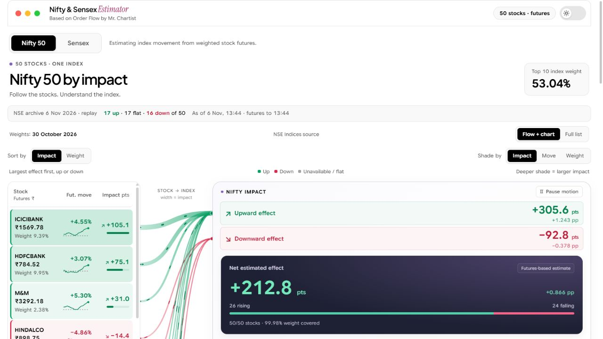
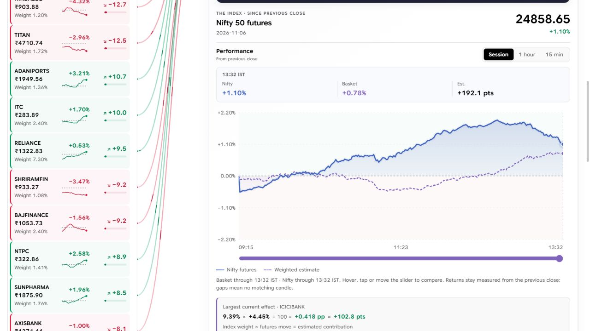
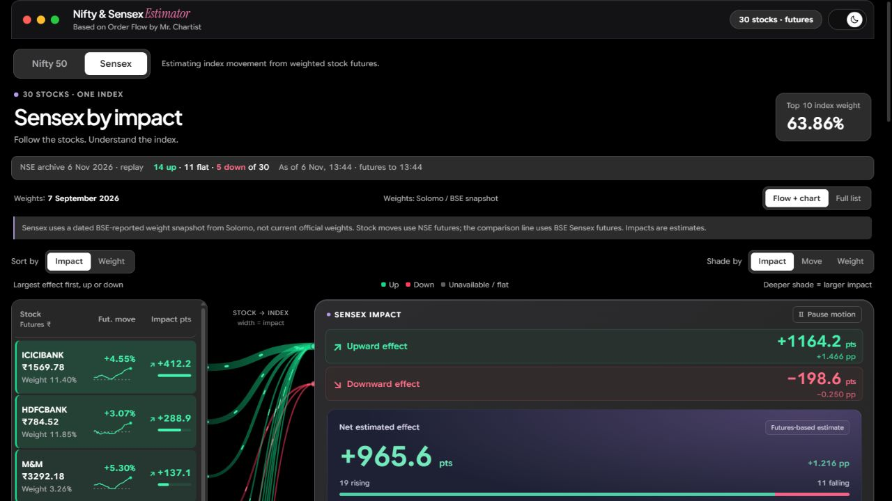
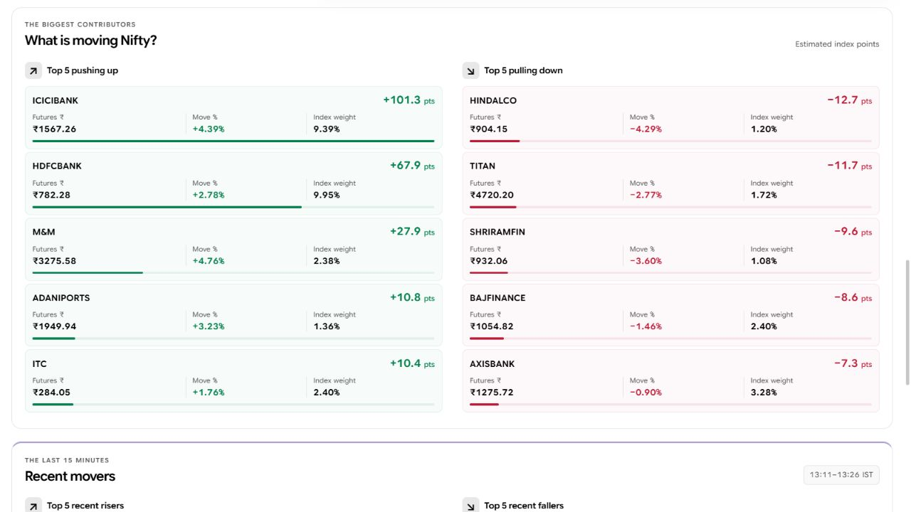
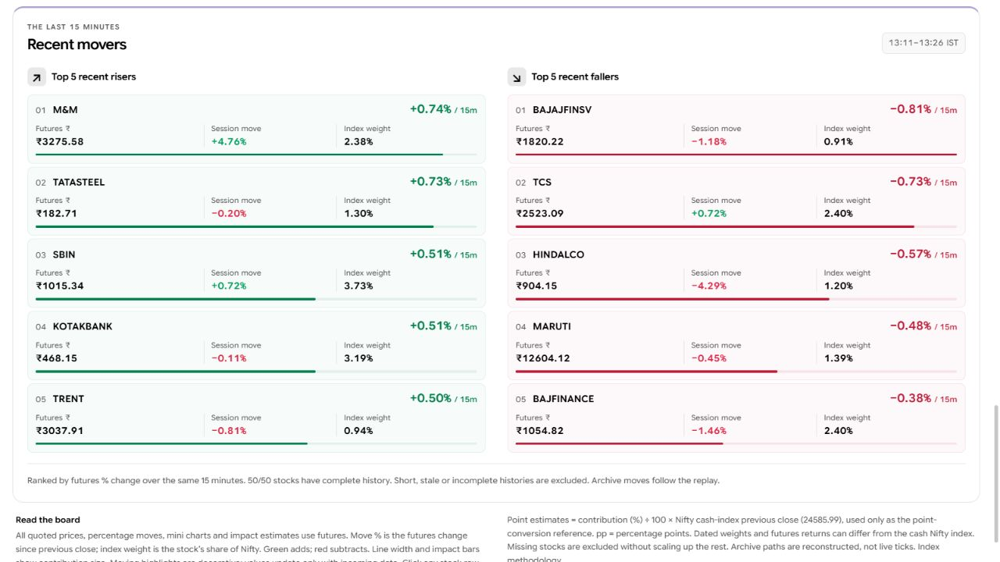
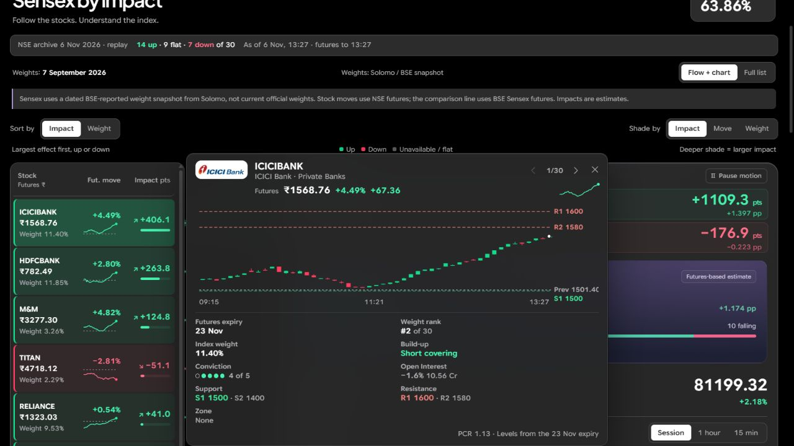

# Nifty & Sensex Estimator

**Estimating index movement from weighted stock futures.**

Combine constituent futures movements with their index weights to estimate Nifty 50 and Sensex movement, and compare that estimate with the index future. This is an estimate of movement in the selected session, not a forecast of future prices.

This is a **personal, non-commercial fork** of [MrChartist/order-flow](https://github.com/MrChartist/order-flow), originally created by [Mr. Chartist](https://mrchartist.com). The original [licence](LICENSE), copyright notice and [third-party notices](NOTICE.md) are preserved.

> **Current data mode: archive replay.** These screenshots use the bundled **6 November 2026** session. Exchange closing figures are real; the intraday paths are reconstructed. A live broker feed is **not connected**.

[Windows setup](docs/WINDOWS_SETUP.md) · [Screenshots](docs/screenshots/README.md) · [What changed](CUSTOMIZATIONS.md) · [Provider integration](PROVIDERS.md)



*Nifty 50, light theme, sorted by largest absolute estimated impact. Captured 8 November 2026 from archive replay.*

## What this version includes

| Feature | What you can do |
|---|---|
| Nifty 50 / Sensex tabs | Switch between 50 Nifty constituents and 30 Sensex constituents. |
| Impact / Weight sorting | Put the largest estimated effects first, or the highest published weights first. Impact uses magnitude, whether positive or negative. |
| Separate price, move and weight labels | Read the futures price in rupees, session change in percent, index weight in percent and estimated impact in points. |
| Visual contribution flow | Follow green upward and red downward contributions; line width indicates estimated impact. Pause the decorative motion. |
| Interactive comparison chart | Compare the index future with the weighted stock estimate; select Session, 1 hour or 15 min and inspect times with the chart or slider. |
| Daily contributors | See the top five pushing up and pulling down, ranked by estimated index-point contribution. |
| Recent movers | See the top five risers and fallers over the same 15-minute window, ranked by futures percentage change. |
| Stock detail | Click a stock in the left list or a contributor card to open its futures candles, expiry, weight and available open-interest context. |
| View controls | Switch between Flow + chart and Full list; shade stocks by impact, movement or weight; use light or dark theme. |

## Quick start on Windows

For download instructions, missing-software checks and troubleshooting, follow the [step-by-step Windows guide](docs/WINDOWS_SETUP.md). **Node.js 22.18 or newer is required. Git is optional.**

Get your own copy of this fork using Git:

```powershell
git clone https://github.com/azad1/order-flow.git
```

Open that folder:

```powershell
Set-Location .\order-flow
```

Install the project's local packages:

```powershell
npm.cmd install
```

Start the bundled archive replay:

```powershell
npm.cmd run dev:archive
```

Open **http://127.0.0.1:5195/** and keep the terminal open. Stop with **Ctrl+C**. Next time, open PowerShell in the same folder and run the start command again; installation is only needed initially or when dependencies change.

**No Git?** Download [this fork as a ZIP](https://github.com/azad1/order-flow/archive/refs/heads/main.zip), extract it, and open PowerShell inside the extracted folder containing `package.json`. Then use the install and start commands above.

**First check:** the status should say **NSE archive … · replay**. Wait for the futures loading count to finish, try both index tabs, and click a stock. The date shown is the replay session, not necessarily today's date.

## Screenshots of this fork

All six screenshots show the current custom interface. They are actual captures of the running app, not mock-ups. Captured on **8 November 2026** at different moments of the **6 November 2026 archive replay**; values therefore differ between images. All displayed market quote prices are futures prices.

### Index future versus the weighted estimate



The solid line is the index future's percentage change. The dashed line is the weighted estimate from constituent futures. Hover, tap or move the slider to compare values at a selected time.

<details>
<summary><strong>Sensex in dark theme</strong></summary>



Sensex uses its own membership and weights, NSE stock futures, and BSE Sensex futures for the comparison line.

</details>

<details>
<summary><strong>Top five daily contributors in each direction</strong></summary>



These rankings answer: which stocks have the largest estimated effect since the previous close?

</details>

<details>
<summary><strong>Top five recent risers and fallers</strong></summary>



These rankings answer: which futures moved most over the recent 15-minute window? The large percentage is the recent move; the separate Session move field covers the day. Missing or incomplete histories are excluded.

</details>

<details>
<summary><strong>Stock futures detail opened from the left list</strong></summary>



Click a stock row or contributor card to open details. Use the close button or Escape to close the panel.

</details>

The original project's screenshots remain in `docs/order-flow-*.webp` as upstream assets; they are not screenshots of this custom layout.

## Reading the numbers

| Label | Meaning |
|---|---|
| **Futures ₹** | The selected future's price in rupees. Missing futures remain unavailable; a cash quote is not substituted. |
| **Fut. move / Move % / Session move** | Futures percentage change since the previous session's close. |
| **Index weight** | The constituent's share of the index from the dated weight snapshot. This is different from its price change. |
| **Impact pts** | Estimated index-point contribution calculated from weight, futures change and the cash-index previous close. |
| **Nifty 50 / Sensex futures** | The actual index-futures series supplied by the selected provider—in these screenshots, the archive replay provider. |
| **Weighted estimate / Basket** | A calculated series combining the constituent futures returns and their index weights. It is not an exchange-published index quote. |
| **Weight covered** | How much of the dated index weight has usable futures data. Missing stocks are excluded without increasing the other weights. |

```text
Estimated contribution (percentage points) = weight (%) × futures move (%) / 100
Estimated index points = contribution (percentage points) × cash-index previous close / 100
```

Example only: a stock with a 10% index weight and a +1% futures move contributes an estimated +0.10 percentage points, or +25 points when the index's previous close is 25,000.

The cash-index previous close is only the point-conversion reference. Futures basis, contract selection, dated weights and incomplete data can make the estimate differ from the actual index future. Moving connector highlights are decorative; prices change only when data arrives.

## Data modes and freshness

| Mode | Windows command | What it means |
|---|---|---|
| Archive replay | `npm.cmd run dev:archive` | Exchange end-of-day figures with reconstructed intraday paths. Bundled session: 6 November 2026. |
| Recorded replay | `npm.cmd run dev:recorded` | Replays the bundled recorded sessions. See their [data notes](data/recorded/README.md). |
| Demo | `npm.cmd run dev` | Simulated market by default, unless a provider is explicitly configured in the process environment. |
| Your own provider | See [Connect any API](#connect-any-api) | Requires a suitable API or adapter, credentials where required, and verification. No live connection is enabled by this fork. |

To fetch the latest **published completed session**, stop the app, run:

```powershell
npm.cmd run fetch:nse
```

Then start archive replay again. This downloads exchange archives; it does not subscribe to live ticks. See [archive data notes](data/archive/README.md).

- **Nifty weights:** 30 October 2026 snapshot; sources are recorded in [nifty50-weights.json](src/features/market-flow/nifty50-weights.json).
- **Sensex weights:** 7 September 2026 secondary reproduction of a BSE-reported snapshot; membership checked for 30 October 2026. This is labelled in the interface. See [sensex-weights.json](src/features/market-flow/sensex-weights.json).
- **Storage:** archives in `data/archive/`, recorded sessions in `data/recorded/`, and local runtime snapshots in `server/data/` (ignored by Git).
- **Broker status:** no working Kotak Neo, Angel One or direct exchange live adapter has been added. The optional Kotak encryption helpers are unfinished and are not part of the archive setup.

## One process for the built page and API

From the project folder, build the page:

```powershell
npm.cmd run build
```

Then explicitly start archive mode:

```powershell
npm.cmd run start:archive
```

Open **http://127.0.0.1:8787/**. Stop the development server first so both processes do not try to use the API port. Plain `npm.cmd start` uses the default/configured provider; it does not explicitly select archive mode.

## Connect any API

This is optional and is **not required for replay**. A broker account and an API key alone do not create an adapter. The service must provide the expiry, option-chain and futures data shapes described in [PROVIDERS.md](PROVIDERS.md).

The current Node launcher does **not automatically load `.env`**. After making a local `.env` from `.env.example` and filling its provider settings privately, explicitly load it for each command:

```powershell
node --env-file=.env server/checkProvider.mjs
```

Resolve any `FIX` results before starting:

```powershell
node --env-file=.env scripts/dev.mjs
```

The basic HTTP-provider settings belong in the local `.env` file:

```dotenv
MF_PROVIDER=http
MF_HTTP_BASE_URL=https://your-data-service.example
```

| Optional setting | Purpose |
|---|---|
| `MF_HTTP_TOKEN` | A token sent as an Authorization bearer header. |
| `MF_HTTP_HEADERS` | Extra headers as a JSON object. |
| `MF_HTTP_EXPIRIES`, `MF_HTTP_CHAIN`, `MF_HTTP_FUTURES` | Endpoint templates; defaults follow the provider contract. |
| `MF_HTTP_MAP` | Path to a map module when the service uses a different JSON shape; see [the example](examples/http-map.example.mjs). |
| `MF_HTTP_RPS` | Request-rate limit. |
| `MF_HTTP_LABEL` | A readable provider name. |

Keep API keys, tokens, PINs and login details local. Never paste them into issues, screenshots or commits. `.env`, local runtime data and encrypted credential files are excluded by Git rules. See [SECURITY.md](SECURITY.md).

## More details

- [Windows installation, restart, stop and troubleshooting](docs/WINDOWS_SETUP.md)
- [Custom features, calculation caveats and dated weights](CUSTOMIZATIONS.md)
- [Screenshot gallery and capture details](docs/screenshots/README.md)
- [Provider contract and adapter guide](PROVIDERS.md)
- [Contribution guide](CONTRIBUTING.md)
- [Original project and its documentation](https://github.com/MrChartist/order-flow)

For code changes, the project's checks are `npm.cmd run lint`, `npm.cmd test` and `npm.cmd run build`.

## Attribution and licence

Order Flow was created by **[Mr. Chartist](https://mrchartist.com)**. This fork adds the Nifty/Sensex impact dashboard and retains the original history, branding, copyright and licence. It is not an official release or an endorsement by the original author, a broker or an exchange.

The original **PolyForm Noncommercial 1.0.0** terms remain in [LICENSE](LICENSE). Third-party fonts, marks, data and dependencies retain their own terms; see [NOTICE.md](NOTICE.md). Company logos identify the instruments.

Required Notice: Copyright (c) 2026 Mr. Chartist (https://mrchartist.com)

**This is an information and research tool, not investment advice.**
