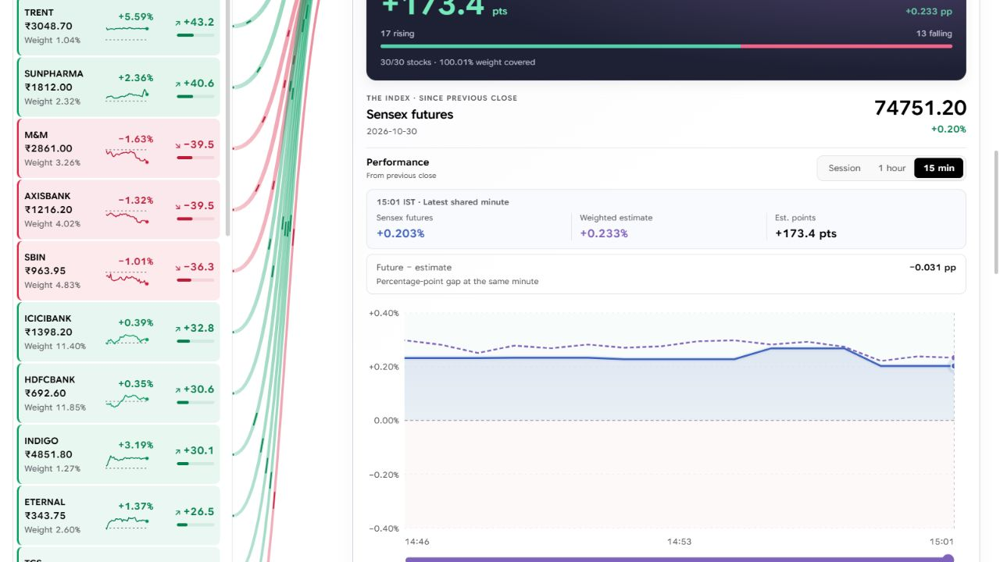
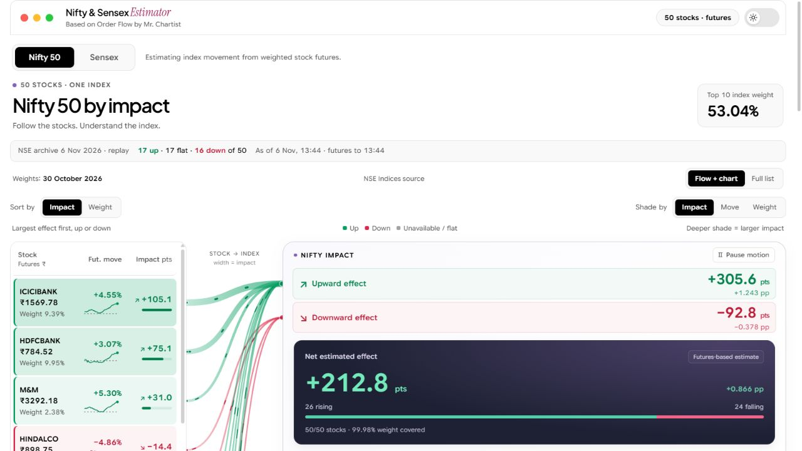
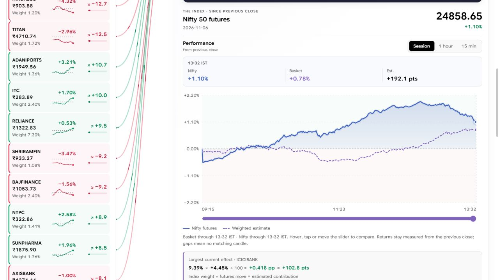
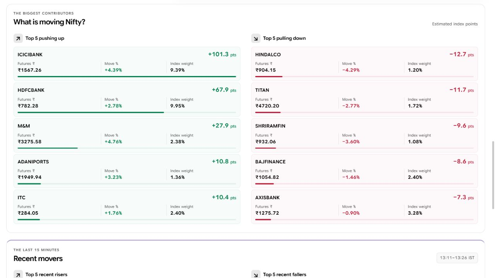
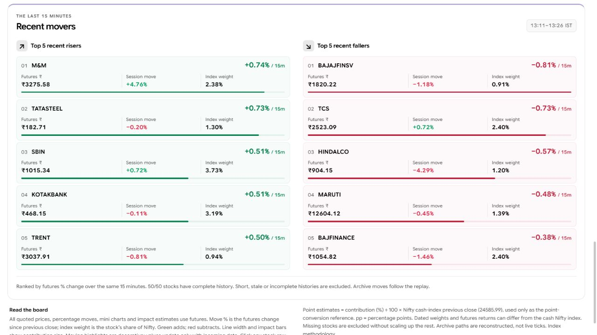
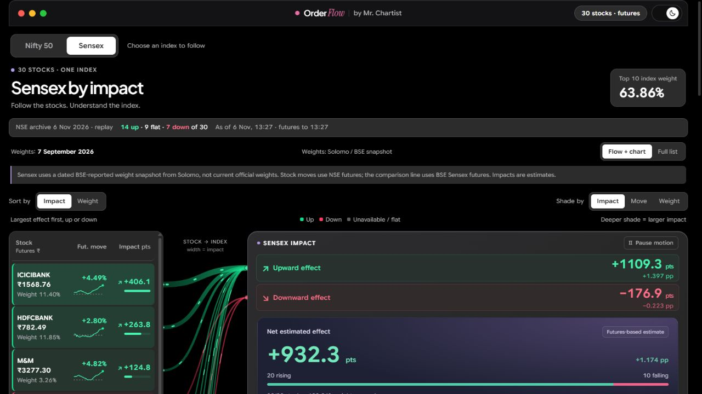
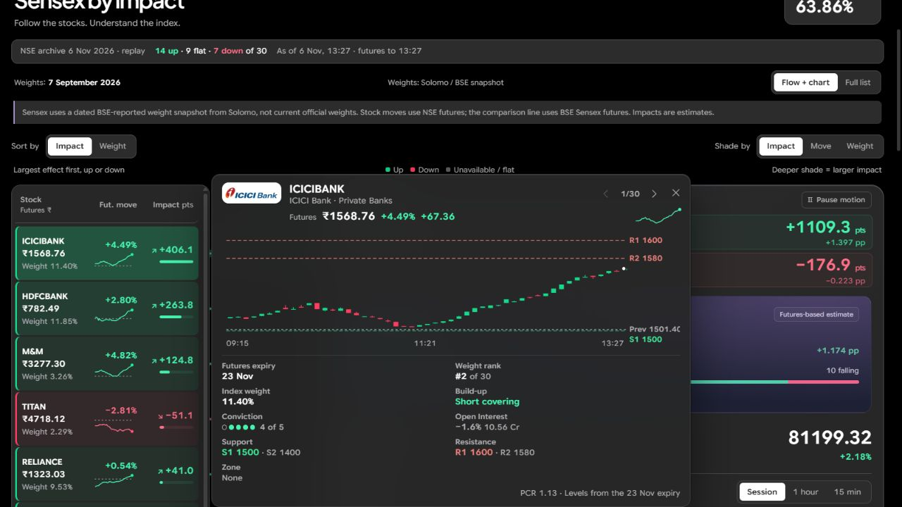

# Nifty & Sensex Estimator screenshots

These are unedited captures of the running Nifty/Sensex fork, taken on **8 November 2026**. The latest comparison below uses the recorded **30 October 2026** session. The six older captures use the **6 November 2026 exchange archive session**. They are documentation examples, not current quotes, live-feed verification or trading recommendations.

Each capture was taken at a different replay time. In archive mode, exchange closing figures are real and intraday paths are reconstructed. Recorded mode uses the stored one-minute futures candles. The status date and timestamp identify the replay. Moving connector highlights are decorative.

[Back to README](../../README.md) · [Windows setup](../WINDOWS_SETUP.md) · [Calculation notes](../../CUSTOMIZATIONS.md)

## Current recorded comparison

Sensex futures and the weighted stock-futures estimate at the same observed minute, with their difference in percentage points. The session is **30 October 2026**. Sensex weights are from **7 September 2026**, an older snapshot flagged in the board's data-quality card. This is recorded replay, not a live feed.

The following six images document the earlier archive-replay view.

## Nifty 50 overview — light theme

The left list separates futures prices, futures moves, index weights and estimated point impacts. Impact sorting puts the largest absolute effects first.

## Index-futures comparison chart

The index future and weighted estimate are separate series. Use the time-range buttons and slider to inspect the replay.

## Daily contributors

Top five positive and negative contributions since the previous close, ranked by estimated index points.

## Recent movers

Top five risers and fallers ranked by futures percentage change over the same 15-minute window. These rankings are different from the daily contribution rankings.

## Sensex overview — dark theme

The dated weight-source notice is visible. Stock moves use NSE futures; the benchmark is BSE Sensex futures.

## Stock futures detail

Opened by clicking ICICIBANK in the left stock list. Contributor cards open the same detail panel.

## Updating these captures

1. Run `npm.cmd run dev:recorded` from the project folder and open the printed local address. Use `dev:archive` only when specifically documenting reconstructed archive mode.
2. Wait until futures finish loading. Record the displayed session date.
3. Use the Nifty/Sensex tabs and the theme switch for the relevant view.
4. Scroll to the chart, daily contributors and recent movers. Open a stock from the left list for the detail view.
5. Save actual browser screenshots without changing the market values or hiding source/caveat labels. Do not include account or credential screens.
6. Update this capture date and the README captions when replacing the images.

The upstream screenshot assets remain in `docs/order-flow-*.webp`. Original software and branding: [Mr. Chartist](https://mrchartist.com). See [LICENSE](../../LICENSE) and [NOTICE.md](../../NOTICE.md).
